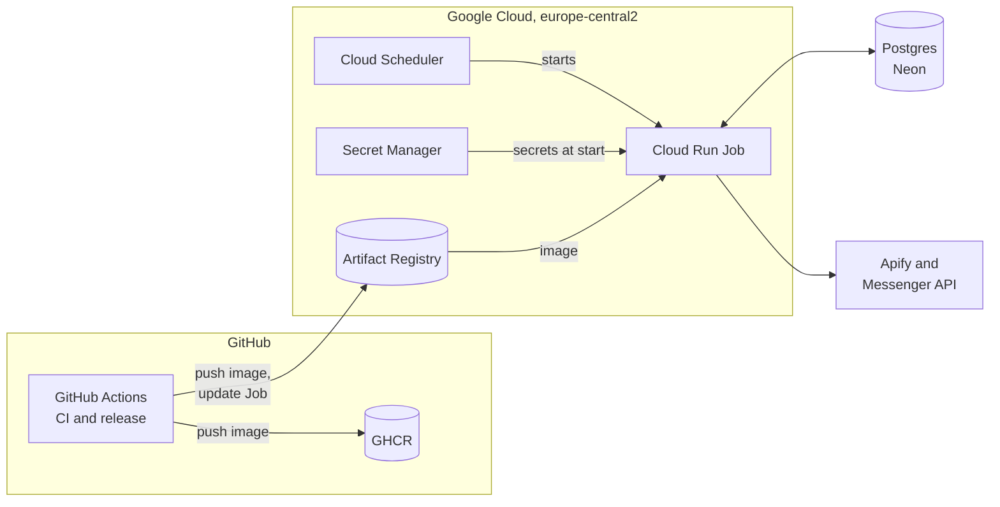

# Architecture

menu-courier runs as a serverless batch job. Cloud Scheduler starts a Cloud Run Job a few times a day; the Job reads its secrets from Secret Manager, scrapes the subscribed pages, delivers new posts through Messenger, and records the outcome in Postgres. GitHub Actions tests the code and, on a release tag, publishes the image and updates the Job.

## Components

| Component | Details |
|---|---|
| Cloud Scheduler `menu-courier-run` | Cron `17 1,6,8 * * *` (UTC). Sends an authenticated request to the Cloud Run Admin API to run the Job. |
| Cloud Run Job `menu-courier` | 1 vCPU, 1 GiB, 600 s task timeout, no retries. Runs `python -m menu_courier.cli run`. |
| Artifact Registry `menu-courier` | Docker repository the Job pulls from. Cleanup policies keep the 5 newest versions and delete untagged images after 7 days and anything older than 30 days. |
| GHCR | Second copy of every released image, kept as a fallback and visible next to the code. |
| Secret Manager | `DATABASE_URL`, `FB_PAGE_ACCESS_TOKEN`, `APIFY_API_TOKEN`, injected as environment variables at start. |
| Neon Postgres | Subscriptions and delivery history. Reached over its public endpoint with TLS (the free plan has no IP allowlist, so a VPC would add nothing). |
| GCS bucket | Terraform state, versioned and private. The only resource created outside Terraform. |

## Identities and permissions

Three service accounts, each with one narrow job:

| Service account | Used by | Permissions |
|---|---|---|
| `menu-courier-job` | the Job at runtime | `secretAccessor` on the three secrets, nothing else |
| `menu-courier-scheduler` | Cloud Scheduler | `run.invoker` on the Job |
| `gh-deployer` | GitHub Actions | `artifactregistry.writer` on the repository, `run.developer` on the Job, `iam.serviceAccountUser` on the runtime account |

## GitHub to Google Cloud authentication

GitHub Actions authenticates with [Workload Identity Federation](https://cloud.google.com/iam/docs/workload-identity-federation), so no service account key is stored anywhere. The workflow requests a short-lived OIDC token from GitHub and exchanges it for access as `gh-deployer`.

- The provider only accepts tokens whose `repository` claim is this repository.
- IAM then allows only identities from this repository to act as `gh-deployer`.

## Release flow

A push of a `v*` tag starts `.github/workflows/release.yml`:

1. **verify-version**: the tag must equal `[project].version` in `pyproject.toml`.
2. **test**: the CI workflow runs as a reusable workflow.
3. **publish**: authenticate with Workload Identity Federation, build the image once, push it to GHCR and Artifact Registry, then update the Cloud Run Job to the new tag.

Pull requests that change application code must bump the version (checked in `ci.yml`).

Terraform manages the shape of the infrastructure; CI manages the image the Job runs, so the Job's image is excluded from Terraform drift detection. See [`infra/README.md`](../infra/README.md).
