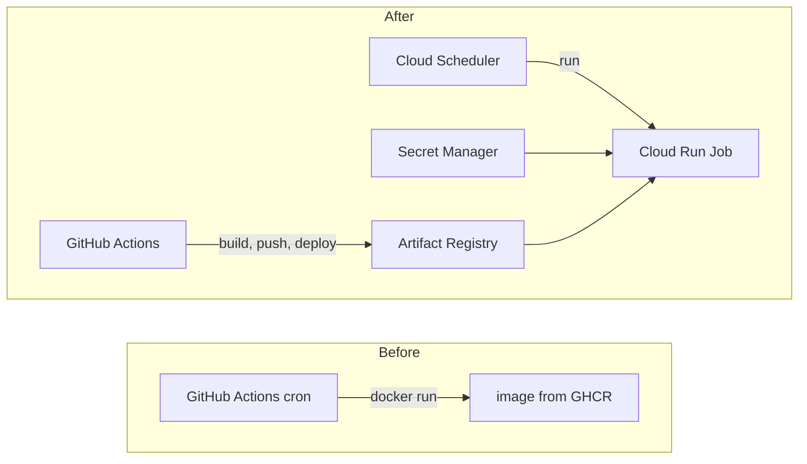

# Migration to Cloud Run Jobs: plan and log

**Status:** completed, October 2026. Tracking issue: [#30](https://github.com/terleckimaciej/menu-courier/issues/30).

This is the working record of moving scheduled execution from a GitHub Actions cron to Google Cloud: the goal, the decisions and why, the steps in the order they were done, and what was measured. The resulting design is described in [architecture](architecture.md); everyday commands are in [operations](operations.md).

## Goal

Run the pipeline (`python -m menu_courier.cli run`) on Google Cloud and keep GitHub Actions for CI/CD only:

> Cloud Scheduler starts a Cloud Run Job, which talks to Neon (Postgres), Apify and Messenger. Secrets come from Secret Manager. GitHub Actions tests, builds and deploys.

Why:

- A cron in GitHub Actions is best-effort: runs can be delayed or skipped, and the schedule is disabled after 60 days without repository activity.
- Secrets belong in a secret store rather than being injected from GitHub Secrets into `docker run`.
- Delivery (CI/CD) and runtime are separate concerns; Cloud Run adds retries and logs.

This is not a scalability change: the workload is one short batch job a few times a day.



## Decisions

| Decision | Chosen | Rejected | Why |
|---|---|---|---|
| Runtime | Cloud Run **Job** | Cloud Run Service | Batch work; no HTTP endpoint needed |
| Scheduling | Cloud Scheduler | Workflows, GitHub Actions cron | One step, so orchestration is unnecessary; the cron stays unreliable |
| Image registry | GHCR and Artifact Registry (one build, two pushes) | Artifact Registry only; remote repository proxying GHCR | GHCR stays visible on GitHub; Cloud Run cannot pull from GHCR directly and a proxy needs a personal access token |
| Region | `europe-central2` | `europe-west3` | Consistency with planned BigQuery use |
| Network to Neon | Public endpoint over TLS | VPC connector and Cloud NAT | The Neon free plan has no IP allowlist, so a VPC adds nothing |
| GitHub to Google Cloud auth | Workload Identity Federation | Service account key | No long-lived credentials |
| Infrastructure as code | Terraform, flat root module, native `google_*` resources | Community modules; `envs/` and `modules/` layout | One application, one environment: modules would add indirection and complicate importing existing resources |
| Terraform state | Versioned GCS bucket | Local state | Recoverable, not tied to one machine |
| Terraform runs | Manual `plan` and `apply` | Automated in CI | No broad permissions granted to GitHub for a personal project |

Neon runs in `eu-central-1` (AWS, Frankfurt). The roughly 20 ms to Warsaw is irrelevant at this scale, and the traffic is a few SQL statements per run.

## Plan and progress

- [x] **1. Project and APIs.** *Done when:* `gcloud config get project` returns the right project and a budget alert exists.
- [x] **2. Artifact Registry and the Cloud Run Job.** *Done when:* `gcloud run jobs execute` succeeds and a cleanup policy is active.
- [x] **3. Secret Manager.** *Done when:* the Job runs with no secrets in plain environment variables.
- [x] **4. Cloud Scheduler.** *Done when:* a scheduled trigger creates an execution.
- [x] **5. CI/CD.** *Done when:* a `v*` tag updates the Job by itself.
- [x] **5b. Run outcome logging and version check.** Issues #16 and #17.
- [x] **6. Cutover.** *Done when:* the old cron is off and the Scheduler delivers on its own.
- [x] **7. Terraform.** *Done when:* `terraform plan` reports no changes.

## Log

### Step 1: project and APIs (2026-10-16)

The project, billing account and a budget alert already existed. APIs enabled for the application:

```bash
gcloud services enable \
  run.googleapis.com cloudscheduler.googleapis.com artifactregistry.googleapis.com \
  secretmanager.googleapis.com iamcredentials.googleapis.com iam.googleapis.com \
  cloudresourcemanager.googleapis.com sts.googleapis.com
```

`gcloud config set project` takes the project **ID**, not the display name shown in the console.

### Step 2: Artifact Registry and the Job (2026-10-17)

A Docker repository in `europe-central2`; image paths use the project ID:
`europe-central2-docker.pkg.dev/<project-id>/menu-courier/menu-courier:<tag>`.

```bash
gcloud artifacts repositories create menu-courier \
  --repository-format docker --location europe-central2
gcloud auth configure-docker europe-central2-docker.pkg.dev
docker tag <image> europe-central2-docker.pkg.dev/<project-id>/menu-courier/menu-courier:manual-1
docker push europe-central2-docker.pkg.dev/<project-id>/menu-courier/menu-courier:manual-1
```

The Docker credential helper is keyed by registry host only; the tag decides which registry a push goes to.

Cleanup policy, because the Artifact Registry free tier is 0.5 GB: keep the 5 newest versions, delete untagged versions after 7 days and anything older than 30 days. `Keep` takes precedence over `Delete`, so the image the Job runs is always protected.

The Job (1 vCPU, 1 GiB, 600 s task timeout, no retries) runs as a dedicated service account. First execution: exit code 0 in **24.4 s** (container start about 6 s), connected to Neon.

### Step 3: Secret Manager (2026-10-17)

`DATABASE_URL`, `FB_PAGE_ACCESS_TOKEN` and `APIFY_API_TOKEN` as secrets with automatic replication, mapped to environment variables on the Job. The runtime service account (`menu-courier-job`) has `secretAccessor` on those three secrets and nothing else, granted per secret.

```bash
gcloud run jobs update menu-courier --region europe-central2 \
  --set-secrets DATABASE_URL=DATABASE_URL:latest,FB_PAGE_ACCESS_TOKEN=FB_PAGE_ACCESS_TOKEN:latest,APIFY_API_TOKEN=APIFY_API_TOKEN:latest
```

`--set-secrets` replaces the whole list, so all three go in each time. Environment variable names must match the application settings exactly (`pydantic-settings`).

### Step 4: Cloud Scheduler (2026-10-17)

A separate service account (`menu-courier-scheduler`) with only `run.invoker` on the Job. The Scheduler job sends a `POST` with an OAuth token to the Cloud Run Admin API:

```bash
gcloud scheduler jobs create http menu-courier-run \
  --location europe-central2 --schedule "17 1,6,8 * * *" --time-zone Etc/UTC \
  --http-method POST \
  --uri "https://run.googleapis.com/v2/projects/<project-id>/locations/europe-central2/jobs/menu-courier:run" \
  --oauth-service-account-email menu-courier-scheduler@<project-id>.iam.gserviceaccount.com
```

Tested with a manual trigger (a Scheduler job must be enabled to be triggered), then paused until the cutover.

### Step 5: CI/CD (2026-10-17, PR #31)

Workload Identity Federation: pool `github`, provider `github-oidc` (issuer `https://token.actions.githubusercontent.com`) with an attribute condition restricting it to this repository. The `gh-deployer` service account has `artifactregistry.writer` on the repository, `run.developer` on the Job and `iam.serviceAccountUser` on the runtime account (needed to deploy a Job that runs as it); the pool may act as it through `workloadIdentityUser`.

```bash
gcloud iam workload-identity-pools create github --location global --display-name "GitHub Actions"
gcloud iam workload-identity-pools providers create-oidc github-oidc \
  --location global --workload-identity-pool github \
  --issuer-uri https://token.actions.githubusercontent.com \
  --attribute-mapping "google.subject=assertion.sub,attribute.repository=assertion.repository" \
  --attribute-condition "assertion.repository=='<owner>/<repo>'"
```

Workflows were split: `ci.yml` runs tests (also reusable via `workflow_call`), and `release.yml` runs on a `v*` tag: tag must match the `pyproject.toml` version, then tests, then one build pushed to GHCR and Artifact Registry, then `gcloud run jobs update`. Project, region and resource names are repository variables, not hardcoded. The first release, `v1.1.2`, completed in 2 min 11 s.

### Step 5b: logging and version check (2026-10-17, PR #32)

Each run logs one line per subscription and a summary (`sent`, `failed`, `already_sent`, `no_matching_post`, `fetch_failed`), so a run can be judged from Cloud Logging. Pull requests that change application code must bump the version. Released as `v1.2.0`.

### Step 6: cutover (2026-10-18)

The old scheduled workflow was disabled (`gh workflow disable`), then the Scheduler job resumed, so the two were never active together. Deliveries are deduplicated by post id in the database, so an accidental overlap would not send twice. The first three scheduled executions (2026-10-19, 01:17, 06:17 and 08:17 UTC) were started by the Scheduler's service account and succeeded, after which the old workflow file was removed.

### Step 7: Terraform (2026-10-18, PR #33)

A flat root module in `infra/` with state in a versioned GCS bucket (the only resource created by hand). Existing resources were adopted with `import` blocks until `terraform plan` reported no changes. Details worth knowing:

- The Job's image is excluded from drift detection; the release workflow updates it.
- A secret's type is part of its identity: changing it forces replacement, which would destroy the stored versions. Secrets have `prevent_destroy`.
- Secret values are not in Terraform, so they never reach the state.
- The Artifact Registry cleanup policy is managed by Terraform and runs in active mode.

See [`infra/README.md`](../infra/README.md).

## Notes

- **Migrations.** `cli run` does not run Alembic; migrations are applied manually before deploying a schema change.
- **Retries.** The Job has no retries. Retrying would not send duplicates (deduplicated by post id), but that has not been exercised.

## Costs and limits

Checked against the vendors' documentation, with the aim of staying at zero:

- **Neon (free plan):** 100 compute-unit hours a month, 1 GB storage, 5 GB egress, autosuspend after 5 minutes. Usage is a few CU-hours a month.
- **Cloud Run Jobs:** one execution typically takes 10-20 s on 1 vCPU and 1 GiB, so about 1,350 vCPU-seconds a month at three runs a day. The pricing page lists a free tier of 240,000 vCPU-seconds and 450,000 GiB-seconds a month ("based on us-central1 pricing"), so usage is under 1% of it. Even with no free tier, the `europe-central2` price (0.0000216 USD per vCPU-second, 0.0000024 USD per GiB-second) comes to about 3 cents a month.
- **Cloud Scheduler:** the first three jobs per billing account are free; this project uses one.
- **Secret Manager:** 6 active versions and 10,000 access operations a month are free, counted per billing account. A version counts as active while enabled **or disabled**, so superseded versions should be destroyed, not disabled. Three secrets, about 360 reads a month.
- **Artifact Registry:** 0.5 GB free; the repository holds under 100 MB and the cleanup policy keeps it bounded.
- **Egress to Neon** (a different provider) is billed as internet egress on the Google side, but it is kilobytes per run.
- **Apify (free plan):** calls are paid in platform credits; the plan includes 5 USD of credit a month, and this workload stays well inside it because posts are fetched once per source, not once per subscription.

## Follow-ups

- Alert on failed executions (Cloud Monitoring).
- Review the retry policy once duplicate delivery on retry is confirmed not to occur.
- Add a connection timeout and retry for the Neon cold start after autosuspend.
