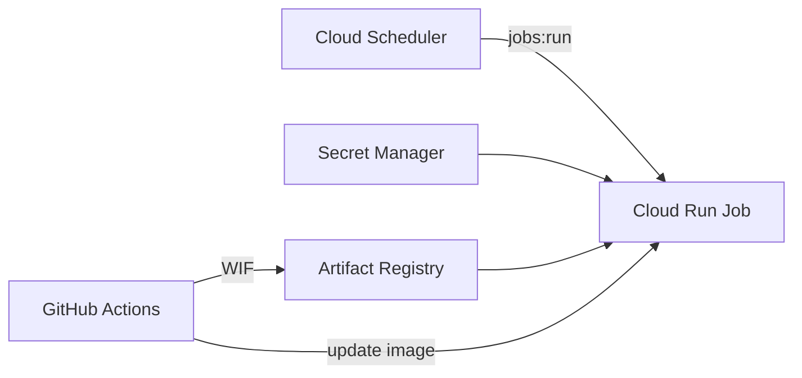

# Infrastructure

Terraform for the GCP resources that run the pipeline: Cloud Scheduler starts a Cloud Run Job on a schedule, the Job reads its secrets from Secret Manager, and GitHub Actions deploys new images through Workload Identity Federation.



A single root module, one environment. State is stored in a GCS bucket.

## Layout

| File | Resources |
|---|---|
| `providers.tf`, `backend.tf`, `locals.tf` | provider and Terraform versions, GCS backend, project constants |
| `apis.tf` | enabled Google APIs |
| `artifact_registry.tf` | Docker repository, cleanup policies, deployer write access |
| `secrets.tf` | secret containers and runtime read access (no secret values) |
| `service_accounts.tf` | runtime, scheduler and deployer service accounts |
| `cloud_run_job.tf` | Cloud Run Job, deployer and scheduler access to it |
| `scheduler.tf` | Cloud Scheduler job |
| `wif.tf` | Workload Identity pool, GitHub OIDC provider, binding to the deployer |
| `outputs.tf` | values for the GitHub repository variables |

## Prerequisites

- Terraform `>= 1.9`
- `gcloud auth application-default login` and `gcloud auth application-default set-quota-project <project-id>`
- The state bucket, the only resource created outside Terraform:

```bash
gcloud storage buckets create gs://<project-id>-tfstate \
  --location <region> --uniform-bucket-level-access --public-access-prevention
gcloud storage buckets update gs://<project-id>-tfstate --versioning
```

## Usage

```bash
cd infra
terraform init
terraform plan
terraform apply
```

Plan and apply are run manually.

## Notes

- **Image tag.** The Job's image is excluded from drift detection (`ignore_changes`). The release workflow updates it on every `v*` tag; Terraform manages the shape of the infrastructure, CI manages what runs on it.
- **Secret values.** Terraform creates the secret containers only, so values never enter the state. Add a value with `gcloud secrets versions add <NAME> --data-file=-`.
- **Deletion guards.** Secrets have `prevent_destroy`, and the Job has `deletion_protection`.
- **GitHub variables.** `.github/workflows/release.yml` reads its GCP settings from repository variables. Terraform only prints them; set or refresh them with:

```bash
terraform output -json github_actions_variables \
  | jq -r 'to_entries[] | "\(.key)\t\(.value)"' \
  | while IFS=$'\t' read -r key value; do gh variable set "$key" --body "$value"; done
```
